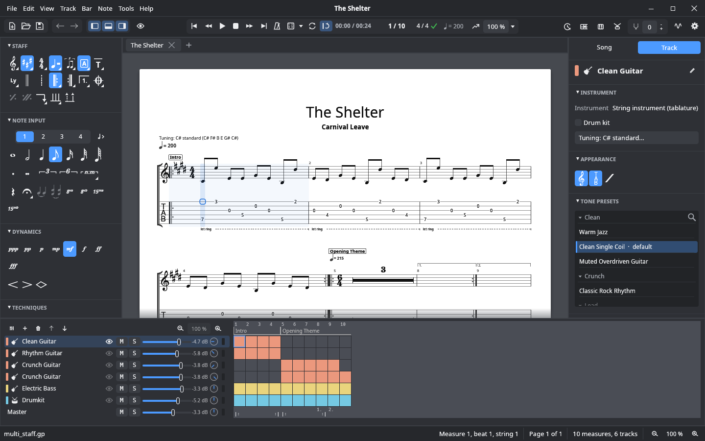
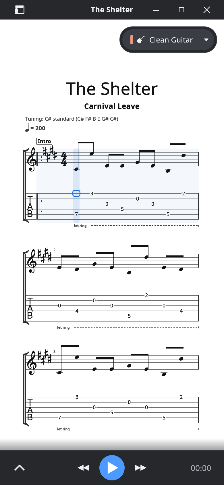
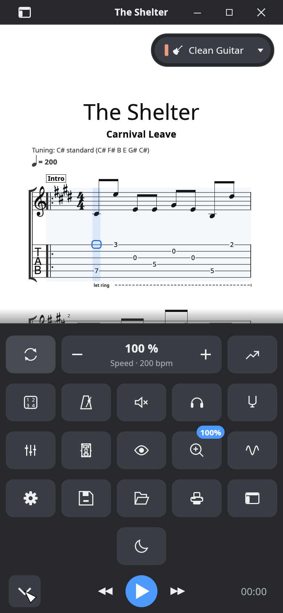

<p align="center">
  <picture>
    <source media="(prefers-color-scheme: dark)" srcset="packaging/guitarscore-logo-dark.svg">
    
  </picture>
</p>

# GuitarScore

**A fast, free guitar tablature editor.** Write tabs at the speed you think, hear them as
you type, and open the Guitar Pro files you already have. Native, written in Rust, and
built never to lose your work.



## Why GuitarScore

- **Native and light.** One binary, no account, no cloud; on the desktop and in the browser. MIT.
- **Your Guitar Pro files.** Opens Guitar Pro 3 to 7+, saves Guitar Pro 7; exports MIDI and PDF.
- **Never lose work.** A recovery journal brings your document back after a crash.
- **Hear it.** Modelled guitars and basses with amp and effects, a mixer, a synthesizer for the rest.
- **Enter it your way.** A key for every action, or play the notes in on a MIDI keyboard or guitar.
- **The whole song.** Notation and tab with every technique, and a song grid with sections.
- **Practice anywhere.** A practice view for phones and tablets: score, player, loop and speed.

<p align="center">
  
  &nbsp;
  
</p>

## Installation

**Try it in your browser:** [gerrit91.github.io/guitarscore](https://gerrit91.github.io/guitarscore/)
runs the latest release, nothing to install. Your songs stay on your disk; the first visit
downloads about 10 MB (the editor and its sounds), later visits start from the cache and
work offline.

Builds for Linux, Windows and macOS are attached to
[GitHub Releases](https://github.com/Gerrit91/guitarscore/releases). Each release
also has a `SHA256SUMS` file to check a download with: `sha256sum -c --ignore-missing
SHA256SUMS` on Linux, `shasum -a 256 -c --ignore-missing SHA256SUMS` on macOS, or
`Get-FileHash <file>` in PowerShell on Windows (compare it with the file's line).

## Status

Early and in active development: it edits real songs today, but it is not yet a complete
Guitar Pro replacement. [`docs/parity.md`](docs/parity.md) tracks every Guitar Pro
feature, [`docs/gaps.md`](docs/gaps.md) the known shortfalls. Bug reports with a file
that misbehaves are especially welcome.

## Development 

To build from source, install Rust with [rustup](https://rustup.rs) (on Linux also the ALSA development
files: `alsa-lib` or `libasound2-dev`), then:

```bash
git clone https://github.com/Gerrit91/guitarscore
cd guitarscore
cargo gui testdata/basic/ornaments.gp   # build and start the app with a sample song
```

For sound, the app needs a General MIDI SoundFont (release builds include one), for
example `pacman -S soundfont-fluid`. Keys, sound and the `gscore-cli` command-line tool
are described in [`docs/usage.md`](docs/usage.md); the browser build in
[`docs/web.md`](docs/web.md).

## Contributing

GuitarScore is a Cargo workspace of small, layered crates, from the Guitar Pro reader
(`gscore-gp`) up to the app (`gscore-app`). `cargo xtask ci` is the definition of done.
[`docs/architecture.md`](docs/architecture.md) describes the design,
[`docs/development.md`](docs/development.md) the tooling, and [`AGENTS.md`](AGENTS.md)
the rules for contributors, human or AI.

## License

MIT, see [`LICENSE`](LICENSE); third-party code and assets are listed in
[`THIRD_PARTY.md`](THIRD_PARTY.md). Reading and writing Guitar Pro files is based on the
[`guitarpro`](https://github.com/slundi/guitarpro) crate by **slundi** (MIT); its modified
copy is the `gscore-gp` crate, and [`docs/guitarpro.md`](docs/guitarpro.md) lists the
changes. Many thanks for making the Guitar Pro formats accessible.
