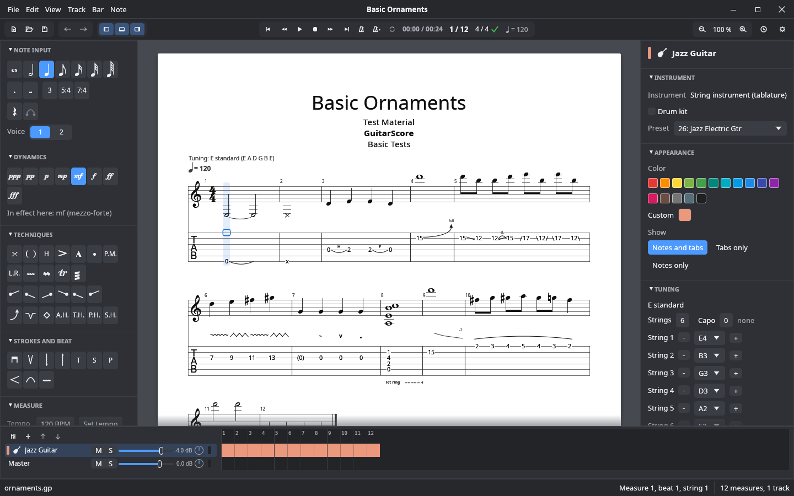
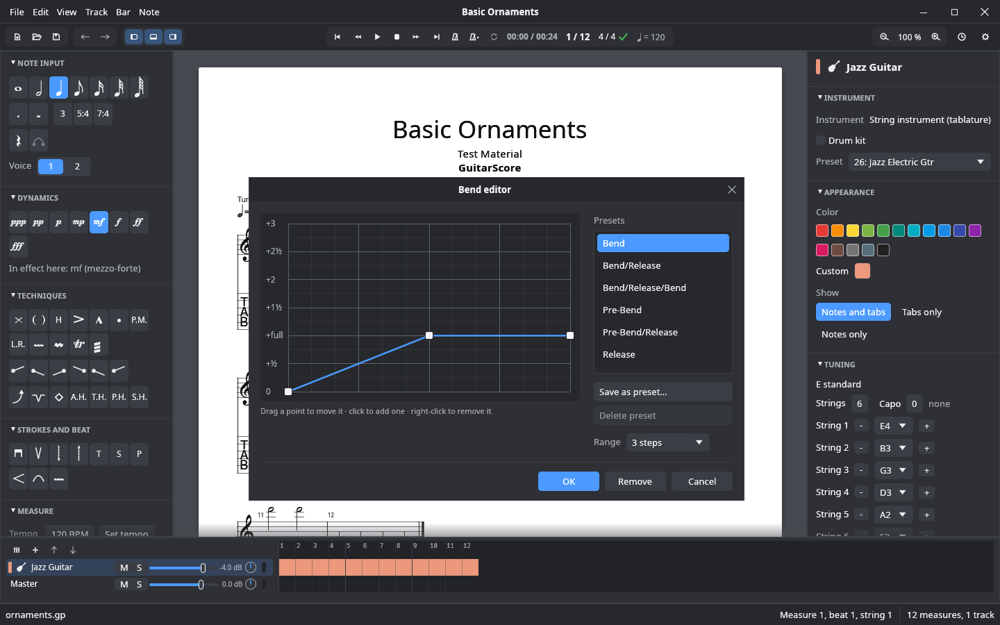
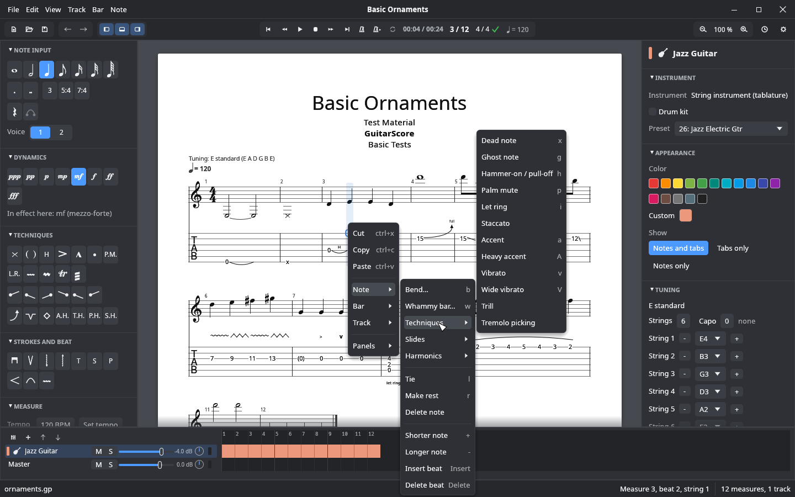

# GuitarScore

**A fast, free guitar tablature editor for the desktop.** Write tabs at the speed you
think, hear them as you type, and open the Guitar Pro files you already have. Native,
written in Rust, Linux first, and built never to lose your work.



## Why GuitarScore

- **Keyboard first.** Type a fret, press `+` for a shorter note, arrow on. Every action
  has a key, and keys follow the character you type, so `+` is `+` on QWERTY, QWERTZ and
  AZERTY alike. Rebind anything in the built-in shortcut editor.
- **Your Guitar Pro files.** Opens Guitar Pro 3, 4, 5, 6 and 7+ (`.gp3` to `.gp`) and
  saves Guitar Pro 7. Saving tells you before anything would be lost and keeps a `.bak`
  of the previous file.
- **Never lose work.** Every edit goes to a recovery journal, never into your file. After a
  crash (or a power cut), the next start offers your document back, undo history
  included. A broken file gives an error message, never a crash.
- **Hear it.** A built-in synthesizer plays every track with tempo changes, repeats, ties,
  bends, slides and dynamics; or send it to any MIDI synthesizer. Notes you type sound at
  once.
- **Native and light.** One binary, GPU-rendered, no Electron, no account, no cloud. MIT
  licensed.

## What you can do

**Write.** Notes from whole to 64th, dots, triplets and other tuplets, rests, ties, two
voices, copy/cut/paste across bars, and unlimited undo with a history window you can
jump around in.

**Every technique, a click or key away.** Hammer-ons, slides, bends, whammy bar, vibrato,
harmonics, palm mute, let ring, accents, dead and ghost notes, trills, tremolo picking,
strokes, tapping, slap and pop, all from the edit palette, a key, or a right-click on the
note. Bends and whammy dives get their own graph editors: drag the points, or start from
a preset and save your own.



**Notation and tab together.** Standard notation above the tab (or either alone), drum
tracks on a percussion staff, dynamics, tempo changes, section names, repeats and
alternative endings, all laid out as a page in a light or dark theme.

**Right-click anything.** The note, the bar and the track under the mouse each have their
menu, and the same menus sit in the menu bar: insert and delete bars, add, duplicate,
move and delete tracks, toggle techniques with their shortcut shown next to them.



**Arrange and mix.** A song grid with every track and bar, a mixer with volume, pan,
reverb, chorus, mute and solo, and a track panel for the instrument, tuning (with names
such as "Drop D" or "DADGAD"), capo and string count. Play with a metronome and
count-in, loop a selection; the cursor follows the music.

**Script it.** `gscore-cli` reads, converts, renders and edits files from the command
line, with the same undoable commands as the app (see [Command line](#command-line)).

## Status

GuitarScore is in **early, active development**. It edits real songs today, but it is not
a finished Guitar Pro replacement. The score is one track on one endless page: pages,
multi-track scores, PDF and printing are the next milestone. Some techniques in playback, WAV
export, drum tab and a few notation details are still missing, and there are no release
packages yet (build it from source, below; it takes a few minutes). [`docs/parity.md`](docs/parity.md)
tracks every Guitar Pro feature (live, partial, missing), [`docs/gaps.md`](docs/gaps.md)
the known shortfalls, and [`docs/devlog.md`](docs/devlog.md) what changed when.

Bug reports with a file that misbehaves are especially welcome.

## Getting started

Install Rust with [rustup](https://rustup.rs), then:

```bash
git clone https://github.com/Gerrit91/guitarscore
cd guitarscore
cargo gui testdata/basic/ornaments.gp   # build and start the app with a sample song
```

On Linux, building needs the ALSA development files (`alsa-lib` on Arch, `libasound2-dev`
on Debian/Ubuntu). For sound, install a General MIDI SoundFont, for example
`pacman -S soundfont-fluid` (see [Sound](#sound)).

### Keyboard

| Key | Does |
|---|---|
| Arrows | Move between beats and strings (click a note to jump there) |
| `0`–`9` | Type a fret; two digits typed quickly make one number (`1` `2` is fret 12) |
| `+` / `-` | Shorter / longer note |
| Insert / Delete | Add / remove a beat; with Ctrl: a bar |
| Right at the end of a bar | Fill it with rests, then start a new bar |
| Shift+arrows | Select beats |
| `b` / `w` | Bend / whammy bar editor |
| `p`, `h`, `v`, `x`, `g` … | Palm mute, hammer-on, vibrato, dead note, ghost note …; the palette's tooltips show every key |
| Ctrl+Z / Ctrl+Y | Undo / redo |
| Ctrl+C / Ctrl+X / Ctrl+V | Copy / cut / paste |
| Space | Play / pause |
| Ctrl+S | Save |
| F11 | Full screen |

Change any key in Settings → Editor. The keymap can also live in a text file
(`~/.config/guitarscore/keymap.txt` on Linux): `gscore-cli keymap` prints the built-in one
and every action id, and `gscore-cli keymap --check <file>` checks a file. A broken keymap
is reported and the built-in one is used.

## Building

`rust-toolchain.toml` pins the Rust version and installs `rustfmt`, `clippy` and the
`wasm32-unknown-unknown` target. With a distribution's Rust instead, install the wasm
target yourself (Arch: `pacman -S rust-wasm`). Building the Guitar Pro reader for wasm also
needs `clang`.

```bash
cargo build
cargo xtask ci   # everything a change must pass: fmt, clippy, tests, layer and wasm checks
cargo gui testdata/basic/note_lengths.gp      # build and start the app (a cargo alias)
gscore-cli gui testdata/basic/note_lengths.gp # start the built app from the command line
```

The app renders with wgpu (Vulkan, Metal or DirectX 12). Its snapshot tests render
offscreen, so a headless machine needs a Vulkan adapter; without a GPU, Mesa's lavapipe
does it (`mesa-vulkan-drivers` on Debian/Ubuntu, `vulkan-swrast` on Arch, plus
`libvulkan1`/`vulkan-icd-loader`).

### Sound

The built-in synthesizer plays on the default audio device. It needs a General MIDI
SoundFont (`.sf2`; `.sf3` files are not supported) and finds one in this order: the
`GSCORE_SOUNDFONT` variable, `~/.local/share/soundfonts/`, the well-known files in
`/usr/share/soundfonts/` and `/usr/share/sounds/sf2/`, then any `.sf2` there. In the app,
the toolbar's "Output" menu switches between the synthesizer, "Choose SoundFont…" and the
MIDI ports. Play starts at the cursor's note; after a pause it resumes, unless the cursor
was moved meanwhile.

```bash
gscore-cli play testdata/basic/note_lengths.gp                        # built-in synthesizer
gscore-cli play testdata/basic/note_lengths.gp --soundfont my.sf2    # with this SoundFont
gscore-cli play testdata/basic/note_lengths.gp --from 5               # from measure 5
gscore-cli midi testdata/basic/note_lengths.gp -o note_lengths.mid   # export a MIDI file
```

To use an external synthesizer instead, start it and pick its MIDI port (`--port` on the
command line). Without any SoundFont, `play` uses the first MIDI port. With FluidSynth:

```bash
fluidsynth -a pipewire -m alsa_seq -is /usr/share/soundfonts/FluidR3_GM.sf2
gscore-cli ports                                          # list MIDI outputs
gscore-cli play testdata/basic/note_lengths.gp --port FLUID
```

Bends and slides use a borrowed MIDI channel per note, so a bend does not move the rest of
the chord. Remaining technique limits are in `docs/gaps.md` (#11).

## Command line

```bash
cargo run -p gscore-cli -- --help
cargo run -p gscore-cli -- info testdata/basic/steel_guitar_dadgad.gp
```

```
Format:       Guitar Pro 7+ (.gp)
Title:        Steel Guitar DADGAD
Subtitle:     Test Material
Artist:       GuitarScore
...
Tracks:       1
  track 1: Steel Guitar: Steel Guitar, 6 strings, tuned DADGAD (D2 A2 D3 G3 A3 D4)
```

```bash
cargo run -p gscore-cli -- dump testdata/basic/steel_guitar_dadgad.gp
```

```
track 1: Steel Guitar (DADGAD)

D |-----------------0----------||
A |--------------0-------------||
G |-----------0----------------||
D |--------0-------------------||
A |-----0----------------------||
D |--0-------------------------||
```

- **`info`:** song information, tracks, instruments and tunings, and problems such as
  unfilled measures.
- **`dump`:** the tablature as ASCII tab.
- **`convert`:** saves a file as Guitar Pro 7+ (`.gp`). The song is checked before
  anything is written, the previous file is kept as `.bak`, and the new file replaces it
  atomically.
- **`edit`:** headless editing with undo/redo: set frets, change beat lengths,
  insert/delete beats and measures, from `-c` commands or a script. `gscore-cli commands`
  lists them. Every successful edit still round-trips through the GP7 writer.
- **`render`:** a track's tablature as SVG (`--track N`, `--theme dark`), using the
  bundled Bravura and Noto Sans fonts by name; see `docs/development.md` for viewing it.

```bash
cargo run -p gscore-cli -- commands
cargo run -p gscore-cli -- edit testdata/basic/steel_guitar_dadgad.gp -o edited.gp \
  -c "set_fret track=1 measure=1 beat=1 string=6 fret=7" \
  -c "set_duration measure=1 beat=1 duration=1/8"
cargo run -p gscore-cli -- edit song.gp -o edited.gp --script edits.txt
cargo run -p gscore-cli -- render testdata/basic/note_lengths.gp -o note_lengths.svg
```

A script has one command per line; blank lines and `#` comments are ignored. Positions are
1-based. The same parser drives scripts and `-c`, so a script is a regression test.

Exit codes: 0 success, 1 the command failed (e.g. unreadable file), 2 wrong usage.

## Contributing

GuitarScore is a Cargo workspace of small crates. A crate may only depend on crates in
lower layers; `cargo xtask layers` enforces this.

| Layer | Crate | Purpose |
|---|---|---|
| 0 | `gscore-gp` | Guitar Pro song data and reading/writing of all GP formats |
| 1 | `gscore-model` | The document model the app works with: views, exact durations, positions, checks |
| 2 | `gscore-io` | Safe entry point for files: format detection, size limits, crash containment |
| 2 | `gscore-layout` | Tablature layout: draw operations, SVG output, light and dark theme |
| 2 | `gscore-play` | Playback sequencing: MIDI events, channel borrowing for bends/slides, `.mid` writer |
| 3 | `gscore-edit`, `gscore-audio` | Editing commands with undo/redo; synthesizer and MIDI output |
| 4 | `gscore-session` | Crash reports, safe saving, recovery journal and crash recovery |
| 5 | `gscore-cli`, `gscore-app` | Command-line tool; desktop app (`guitarscore`) |

`cargo xtask ci` is the definition of done. `docs/architecture.md` describes the design and
`AGENTS.md` holds the rules for contributors, human or AI. Test files made with Guitar Pro
are in `testdata/` (see `testdata/basic/README.md`).

## License

MIT, see `LICENSE`. Third-party code and assets are listed in `THIRD_PARTY.md`.

## Acknowledgements

Reading and writing Guitar Pro files is based on the
[`guitarpro`](https://github.com/slundi/guitarpro) crate by **slundi** (MIT license).
GuitarScore includes a modified copy of its code as the `gscore-gp` crate; the license is kept
next to it (`crates/gscore-gp/LICENSE-guitarpro`), and `docs/guitarpro.md` lists where it came
from and what was changed. Many thanks for making the Guitar Pro formats accessible.
